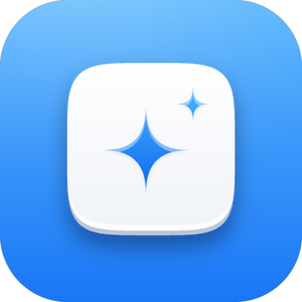
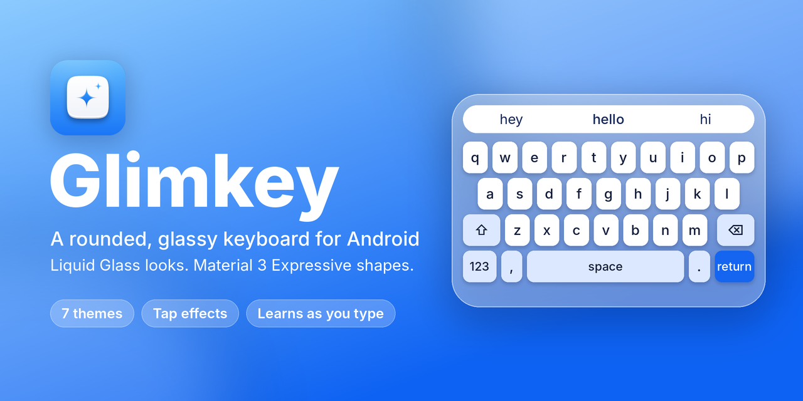

<div align="center">



# Glimkey

**A rounded, glassy keyboard for Android.**<br>
Liquid Glass looks, Material 3 Expressive shapes, and a lot of small details that make typing feel good.

[](https://github.com/mchaworks/Glimkey/actions/workflows/build.yml)
[](LICENSE)


[](#-contributing)
[](#-how-its-made)




</div>

---

## ✨ Highlights

| | |
|---|---|
| 🫧 **Keys that move** | Rounded keys morph into pills on press and settle back with a little spring. Shift and page changes use a soft Blur Replace. |
| 🎨 **7 full themes** | Not just colours: each theme changes shape, material, motion, font and sound. See [THEMES.md](THEMES.md). |
| 💥 **Tap effects** | Ripple, Sparkle, Hearts, Bubbles, Confetti, Petals, plus a back effect behind the keys. Works on any theme. |
| 🧠 **Suggestions that learn** | Word bar, next-word prediction and typo-aware auto-correct. Indonesian and English work at the same time, picked from what you type. All learning stays on your device. |
| 🌐 **Strip button** | One capsule on the word bar: Translate, Clipboard, Text editing, Emoji, Repeat last line, Settings. Swipe to switch, hold to see all. |
| 📳 **Real haptics and sound** | Haptic style, strength and per-key feel, an adaptive mode for fast typing, and a typing sound pack for every theme. |
| 🔒 **Private by design** | No analytics. Nothing you type leaves the phone unless you turn on Translation yourself, and never in password fields. |

## 🎭 Themes

| Theme | Vibe |
|---|---|
| **Liquid Glass** | Frosted shell, optional backdrop blur and glass refraction, Material You colours |
| **Paper** | A lined page with a red margin and index-card keys |
| **Terminal** | Black, scanlines, phosphor green |
| **Mechanical** | Metal case with dished keycaps that sink into the skirt |
| **Clay** | Soft neumorphic keys that press inward |
| **Pixel** | 8-bit notched blocks that drop onto their slab |
| **Nokia LCD** | Green LCD with a pixel grid and keypad tones |

Every theme remembers its own key shape and spacing. Details and code map: [THEMES.md](THEMES.md).

## ⌨️ Typing

- Shift, double-tap caps lock, auto-capitalisation, double-space for ". "
- Hold backspace to repeat, with adjustable delay and speed
- Slide on the space bar to move the cursor, with an optional magnifier loupe
- Smart keys: numpad in number fields, `@` in e-mail fields, `/` and `.com` in web fields
- Optional number row, Gboard-style key hints, one-handed mode, iOS or Gboard layout
- Action key adapts to the field (go / search / send / done / next)
- Clipboard and text-editing panels that replace the keyboard with a Blur Replace
- No globe key: language switching stays with Android's own navigation-bar switcher

## 🛠️ Settings

Everything is in the Glimkey app, organised and searchable.

- **Appearance**: Theme & mode, Colors, Glass & blur, Keys, Effects. A live keyboard preview stays pinned while you tweak.
- **Layout**: layout style, number row, key hints, one-handed mode, bottom spacing, strip button, emoji key.
- **Typing**: suggestions, auto-correction, learning, cursor, key timing, typing stats.
- **Feedback**: haptics and typing sound.
- **Translation**: off by default; service and target language appear once it is on.
- **Advanced**: clear learned data, back up and restore settings, reset.

Each page has **Reset this page**, and options that depend on another one only show while it is on.

## 🚀 Get it

1. Open the **[Actions](https://github.com/mchaworks/Glimkey/actions)** tab, pick the latest successful run and download the `pillboard-debug-apk` artifact.
2. Install the APK, open **Glimkey**, tap **Enable**, switch it on, then tap **Switch**.

Requires Android 8.0 (API 26) or newer. Blur and glass refraction need Android 12 and 13+ respectively; everything else falls back gracefully.

## 🔧 Build from source

You need JDK 17, the Android SDK and Gradle 8.9+.

```sh
sh fonts.sh            # downloads Google Sans Rounded (OFL) into res/font
gradle assembleDebug
```

The APK ends up in `app/build/outputs/apk/debug/app-debug.apk`.

## 🗺️ Project map

```
app/src/main/java/dev/pillboard/keyboard/
├── PillboardService.kt     the keyboard (input, rows, strip, panels)
├── KeyView.kt              one key: press morph, preview bubble, hints
├── KbTheme.kt / KbTokens.kt   themes and everything resolved from them
├── KeyBodyDrawable.kt      keycap skins · GlassSurface.kt: shell and blur
├── TapFx.kt                tap and back effects
├── SuggestCore.kt …        suggestions, lexicon, learning
├── Settings*.kt            the settings app
└── TypingSound.kt, Haptics.kt
app/src/main/assets/        dictionaries (dict/) and sound packs (sounds/)
```

## 🤝 Contributing

PRs are welcome.

- **A new language**: drop `<code>.txt` into `app/src/main/assets/dict/` (format is described at the top of `en.txt`). It is picked up automatically.
- **A new theme**: add an enum entry, a `Palette`, a font overlay and, if you like, a new `KeySkin`. Steps in [THEMES.md](THEMES.md).
- **A new tap effect**: add an enum entry and a branch in `burst()` and `onDraw()` in `TapFx.kt`.
- **Found a bug?** [Open an issue](https://github.com/mchaworks/Glimkey/issues).

Design notes live in [LIQUID_EXPRESSIVE.md](LIQUID_EXPRESSIVE.md).

## 🤖 How it's made

Glimkey is **vibe coded with [Claude](https://claude.ai)**, but the ideas are mine.

Every theme, every feature and every "make it feel like this" came from me, from what I wanted on my own phone. Claude wrote and refactored the Kotlin, and I steered it: tried it, said what felt wrong, and went again. It is a human-led project with an AI pair programmer, and the bugs are shared.

## 📄 License and credits

Glimkey is released under the [MIT License](LICENSE).

- Font: [Google Sans Rounded](https://github.com/tiwa244/Google-Sans-Rounded), SIL OFL 1.1 (`licenses/`).
- Sounds: the Clay, Pixel, LCD, Glass, Paper, Terminal and Mechanical packs are generated in-house. The iOS-style and Thock A/B/C packs are third-party audio kept for personal use only; see `app/src/main/assets/sounds/README.txt` before redistributing builds.

<div align="center">
<sub>Ideas by <a href="https://github.com/mchaworks">@mchaworks</a> · Vibe coded with Claude · Your words stay on your phone.</sub>
</div>
